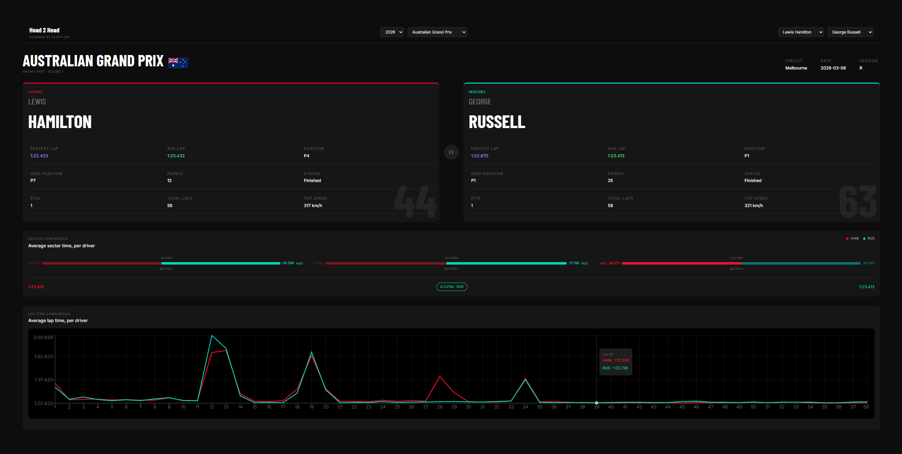

# F1 Head to Head

A full-stack web app for comparing two Formula 1 drivers across a race
weekend — results, sector times, and lap-by-lap race pace — using
official F1 timing data.



## Features

- **Driver comparison** — side-by-side cards with position, grid,
  points, fastest and average lap, pit stops, and top speed
- **Sector comparison** — average sector times per driver, with
  split bars showing where each driver gains or loses time
- **Lap-by-lap pace** — race pace chart with pit stops and
  safety car periods marked _(in progress)_
- **Dynamic selection** — season, race, and driver dropdowns
  populated from the API

## Tech stack

**Backend:** Python, FastAPI, FastF1, Pandas
**Frontend:** React, TypeScript, Vite, Tailwind CSS, Recharts, Axios

## Architecture

The backend uses a router/service split: routers handle HTTP,
services handle all FastF1 and Pandas logic. Raw timing data is
cleaned before it reaches the API — timedeltas converted to seconds,
missing values handled, and pace averages filtered to valid flying
laps so pit and safety car laps don't skew them.

The frontend keeps formatting separate from data: the API returns
raw numbers, and the UI formats them for display.

## Running locally

**Requirements:** Python 3.11+, Node 18+, and an F1 TV Access
subscription (Formula 1 requires one to download timing data).

```bash
# backend — from the project root
python -m venv .venv
.venv\Scripts\activate          # macOS/Linux: source .venv/bin/activate
pip install -r requirements.txt
python -m fastf1 auth f1tv --authenticate
python -m uvicorn app.main:app --reload
```

```bash
# frontend — in a second terminal
cd dashboard
npm install
npm run dev
```

API docs: http://127.0.0.1:8000/docs
App: http://localhost:5173

The first load of any session takes 20–30 seconds while FastF1
downloads it; later loads use the local cache.

## Disclaimer

Data from Formula 1 via [FastF1](https://github.com/theOehrly/Fast-F1).
This is a non-commercial portfolio project and is not affiliated with
or endorsed by Formula 1. Team names and trademarks belong to their
respective owners.
